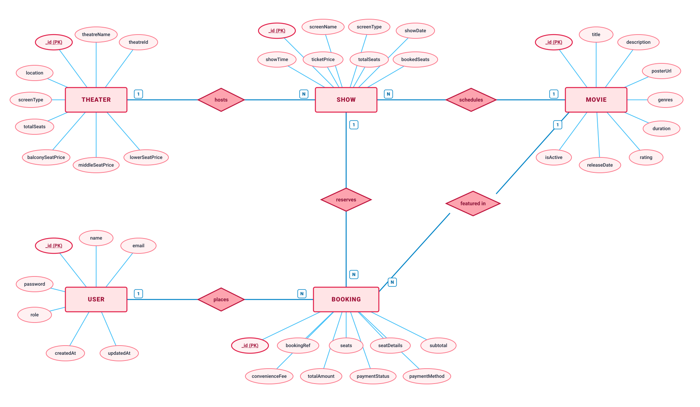
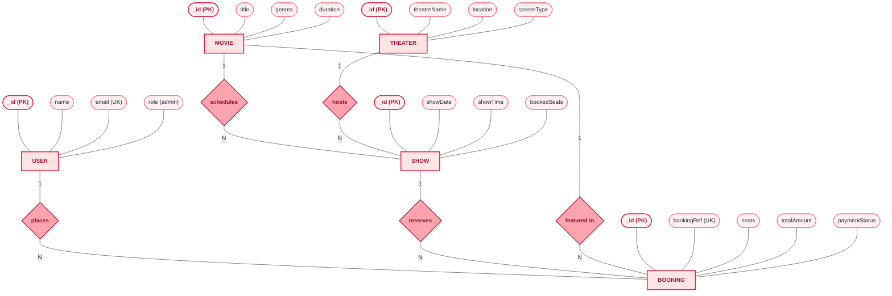
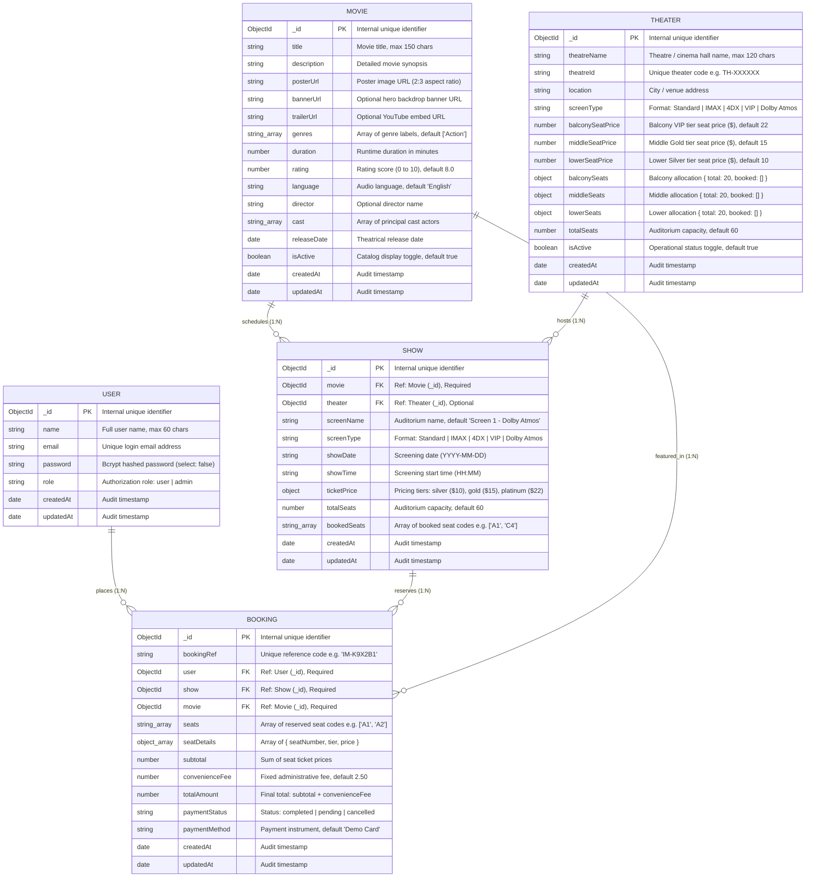

# Entity-Relationship (ER) Diagram & Data Architecture

This document describes the complete database design, entity schemas, relationships, cardinalities, constraints, and indexing strategy for the **IMovies** cinema ticket booking application.

All entity definitions and relationships are strictly derived from the implemented Mongoose models in `backend/models/`.

---

## 1. Visual Entity-Relationship Diagram

### 1.1 Traditional Chen-Style Vector Diagram (SkillWallet Style)

In alignment with the SkillWallet reference project architecture, the system employs the **traditional Chen ER notation**:
- **Entities**: Rendered as **rectangles** (User, Movie, Theater, Show, Booking).
- **Attributes**: Rendered as **ovals / ellipses** connected directly to their parent entity (with primary key attributes underlined).
- **Relationships**: Rendered as **diamond shapes** located between related entities.
- **Cardinalities**: Explicitly annotated with `1` and `N` tags.
- **Palette**: Clean white background, soft red/pink entity & relationship shapes, and light blue connecting lines matching the reference diagram.

The high-resolution vector SVG is generated and ready for direct insertion into project reports:
- **Output File**: [`docs/architecture/er-diagram.svg`](file:///Users/insiya/Projects/IMovies/docs/architecture/er-diagram.svg)
- **Format**: Scalable Vector Graphics (SVG, 1600 × 1260 px, High DPI)

---

### 1.2 Chen-Style Relationship Flowchart

The following diagram illustrates the Chen-style entity rectangles, relationship diamonds, and attribute ovals:

---

### 1.3 Relational Schema Diagram (Crow's Foot View)

For developers and database administrators requiring full attribute types and foreign key links:

---

## 2. Entity Relationships & Cardinalities

1. **User — Booking (`places`, 1:N)**:
   - One `User` can place zero or many `Booking` records over time.
   - Each `Booking` references exactly one `User` via the mandatory foreign key `booking.user`.
   - **Admin Representation**: Administrators are represented directly within the `User` entity via the `role` attribute (`role: 'admin'`). There is **no separate Admin entity**; administrators authenticate through the same pipeline and gain administrative privileges via role verification middleware (`adminOnly`).

2. **Movie — Show (`schedules`, 1:N)**:
   - One `Movie` can have zero or many scheduled screening sessions (`SHOW` records) across different dates, times, and auditoriums.
   - Each `Show` references its scheduled movie via the mandatory foreign key `show.movie`.

3. **Theater — Show (`hosts`, 1:N)**:
   - One `Theater` venue can host zero or many scheduled movie screening sessions.
   - Each `Show` optionally references the physical venue via the foreign key `show.theater`, inheriting venue amenities, screen format, and base tier pricing.

4. **Show — Booking (`reserves`, 1:N)**:
   - One scheduled screening (`Show`) can receive zero or many customer `Booking` records.
   - Each `Booking` explicitly references the reserved screening session via `booking.show`.
   - **Embedded Seat State**: Real-time seat availability is tracked directly on the `Show` document inside `bookedSeats: [String]`. This allows lock-free atomic conditional reservation (`Show.findOneAndUpdate` matching `{ bookedSeats: { $nin: seats } }`) and atomic seat release upon cancellation (`Show.findByIdAndUpdate` with `{ $pull: { bookedSeats: { $in: booking.seats } } }`).

5. **Movie — Booking (`featured in`, 1:N)**:
   - One `Movie` is referenced by zero or many `Booking` records.
   - In addition to the indirect link via `Show`, `Booking` maintains a direct foreign key `booking.movie`. This denormalization enables fast order history queries, receipt rendering, and revenue aggregation without requiring multi-hop population joins.

---

## 3. Structural Design Principles & Schema Integrity

1. **No Redundant Separate Entities**:
   - **Admin**: Modeled as `role = 'admin'` inside the `User` schema.
   - **Seats**: Stored as an array of seat identifier strings (`bookedSeats: [String]`) inside `Show` and seat breakdown items (`seatDetails: [{ seatNumber, tier, price }]`) inside `Booking`. There is **no separate Seat collection**.
   - **Payments**: Modeled as embedded attributes inside `Booking` (`paymentStatus`, `paymentMethod`, `subtotal`, `convenienceFee`, `totalAmount`). There is **no separate Payment collection**.
   - **Reviews**: Not implemented in the data layer; there is **no Review collection**.
2. **Deterministic Querying**: Show dates are stored as ISO calendar strings (`YYYY-MM-DD`) and times as 24-hour strings (`HH:MM`) to eliminate timezone ambiguity during scheduling.

---

## 4. Detailed Schema Definitions

### 4.1 User Entity (`backend/models/User.js`)
Stores registered customer and administrator accounts.

| Field | Type | Required | Constraints / Defaults | Description |
|---|---|---|---|---|
| `_id` | `ObjectId` | Auto | Primary Key (PK) | MongoDB internal document identifier |
| `name` | `String` | Yes | Max 60 chars, trimmed | Full legal or display name |
| `email` | `String` | Yes | Unique, trimmed, lowercase, regex-validated | Account login email address |
| `password` | `String` | Yes | Min 6 chars, `select: false` | Bcrypt-hashed password (cost factor 10) |
| `role` | `String` | No | Enum: `['user', 'admin']`, default `'user'` | Role claim for access control |
| `createdAt` | `Date` | Auto | Mongoose Timestamp | Account creation timestamp |
| `updatedAt` | `Date` | Auto | Mongoose Timestamp | Last profile update timestamp |

**Model Hooks & Methods**:
- `pre('save')`: Hashes `password` using `bcrypt.genSalt(10)` whenever modified.
- `matchPassword(enteredPassword)`: Compares candidate plaintext password with stored bcrypt hash using `bcrypt.compare`.
- `toJSON()`: Strips the `password` field from serialized JSON output to protect credentials.

---

### 4.2 Movie Entity (`backend/models/Movie.js`)
Contains movie catalog metadata, media URLs, runtime, and categorization.

| Field | Type | Required | Constraints / Defaults | Description |
|---|---|---|---|---|
| `_id` | `ObjectId` | Auto | Primary Key (PK) | MongoDB internal document identifier |
| `title` | `String` | Yes | Max 150 chars, trimmed | Movie title |
| `description` | `String` | Yes | Trimmed | Detailed movie synopsis |
| `posterUrl` | `String` | Yes | Trimmed URL | Portrait poster image (2:3 aspect ratio) |
| `bannerUrl` | `String` | No | Trimmed URL | Wide hero spotlight banner image |
| `trailerUrl` | `String` | No | Trimmed URL | YouTube video or trailer URL |
| `genres` | `[String]` | Yes | Default `['Action']` | Array of genre tags (e.g. Action, Sci-Fi) |
| `duration` | `Number` | Yes | Min: 1 minute | Runtime in minutes |
| `rating` | `Number` | No | Min: 0, Max: 10, default `8.0` | Critic / audience rating score |
| `language` | `String` | No | Default `'English'`, trimmed | Audio language |
| `director` | `String` | No | Trimmed | Director name |
| `cast` | `[String]` | No | Default `[]` | Array of principal cast members |
| `releaseDate` | `Date` | No | Default `Date.now` | Theatrical release date |
| `isActive` | `Boolean` | No | Default `true` | Soft toggle for catalog display |
| `createdAt` | `Date` | Auto | Mongoose Timestamp | Audit timestamp |
| `updatedAt` | `Date` | Auto | Mongoose Timestamp | Audit timestamp |

---

### 4.3 Theater Entity (`backend/models/Theater.js` & `theatreModel.js`)
Represents physical cinema complexes, locations, projection screen formats, and tier pricing. Fulfills the SkillWallet Task 1 / Capstone Theater requirement.

| Field | Type | Required | Constraints / Defaults | Description |
|---|---|---|---|---|
| `_id` | `ObjectId` | Auto | Primary Key (PK) | MongoDB internal document identifier |
| `theatreName` | `String` | Yes | Max 120 chars, trimmed | Name of the theater / cinema hall |
| `theatreId` | `String` | No | Auto-generated `TH-XXXXXX` | Human-readable theater identifier |
| `location` | `String` | Yes | Trimmed | City, mall, or street address |
| `screenType` | `String` | No | Enum: `['Standard', 'IMAX', '4DX', 'VIP', 'Dolby Atmos']`, default `'Standard'` | Projection format technology |
| `balconySeatPrice` | `Number` | No | Default `22`, min 0 | Balcony / Platinum VIP seat price ($) |
| `middleSeatPrice` | `Number` | No | Default `15`, min 0 | Middle / Gold seat price ($) |
| `lowerSeatPrice` | `Number` | No | Default `10`, min 0 | Lower / Silver seat price ($) |
| `balconySeats` | `Object` | No | Default `{ total: 20, booked: [] }` | Seat allocation metadata |
| `middleSeats` | `Object` | No | Default `{ total: 20, booked: [] }` | Seat allocation metadata |
| `lowerSeats` | `Object` | No | Default `{ total: 20, booked: [] }` | Seat allocation metadata |
| `totalSeats` | `Number` | No | Default `60` | Total seating capacity |
| `isActive` | `Boolean` | No | Default `true` | Operational status toggle |
| `createdAt` | `Date` | Auto | Mongoose Timestamp | Audit timestamp |
| `updatedAt` | `Date` | Auto | Mongoose Timestamp | Audit timestamp |

---

### 4.4 Show Entity (`backend/models/Show.js`)
Represents an individual scheduled movie screening in an auditorium at a specific date and time, optionally linked to a `Theater`.

| Field | Type | Required | Constraints / Defaults | Description |
|---|---|---|---|---|
| `_id` | `ObjectId` | Auto | Primary Key (PK) | MongoDB internal document identifier |
| `movie` | `ObjectId` | Yes | Ref: `'Movie'` (FK) | Foreign key reference to scheduled movie |
| `theater` | `ObjectId` | No | Ref: `'Theater'` (FK) | Optional foreign key to hosting theater |
| `screenName` | `String` | Yes | Default `'Screen 1 - Dolby Atmos'` | Name/label of auditorium/screen |
| `screenType` | `String` | No | Enum: `['Standard', 'IMAX', '4DX', 'VIP', 'Dolby Atmos']` | Projection format technology |
| `showDate` | `String` | Yes | Format `YYYY-MM-DD` | Calendar screening date |
| `showTime` | `String` | Yes | Format `HH:MM` | Screening start time (24-hour format) |
| `ticketPrice` | `Object` | Yes | Tiered pricing object | `{ silver: 10, gold: 15, platinum: 22 }` |
| `totalSeats` | `Number` | No | Default `60` | Total seating capacity of the auditorium |
| `bookedSeats` | `[String]` | No | Default `[]` | Array of occupied seat identifiers (e.g. `["A1", "C4"]`) |
| `createdAt` | `Date` | Auto | Mongoose Timestamp | Audit timestamp |
| `updatedAt` | `Date` | Auto | Mongoose Timestamp | Audit timestamp |

---

### 4.5 Booking Entity (`backend/models/Booking.js`)
Represents a customer ticket reservation, seat allocations, price breakdown, and digital ticket reference. Supports cancellation with automatic seat release.

| Field | Type | Required | Constraints / Defaults | Description |
|---|---|---|---|---|
| `_id` | `ObjectId` | Auto | Primary Key (PK) | MongoDB internal document identifier |
| `bookingRef` | `String` | Yes | Unique, uppercase, trimmed | Alphanumeric reservation code (e.g. `IM-K8X3F1`) |
| `user` | `ObjectId` | Yes | Ref: `'User'` (FK) | Foreign key to the user who placed booking |
| `show` | `ObjectId` | Yes | Ref: `'Show'` (FK) | Foreign key to the reserved screening |
| `movie` | `ObjectId` | Yes | Ref: `'Movie'` (FK) | Foreign key to the movie for direct lookup |
| `seats` | `[String]` | Yes | Array, min length 1 | Array of reserved seat codes |
| `seatDetails` | `[Object]` | No | Array of `{ seatNumber, tier, price }` | Breakdown of each seat, tier, and price |
| `subtotal` | `Number` | Yes | Calculated | Sum of individual seat prices |
| `convenienceFee` | `Number` | No | Default `2.50` | Fixed administrative convenience fee |
| `totalAmount` | `Number` | Yes | Min: 0 | Final grand total (`subtotal + convenienceFee`) |
| `paymentStatus` | `String` | No | Enum: `['completed', 'pending', 'cancelled']`, default `'completed'` | Payment lifecycle state |
| `paymentMethod` | `String` | No | Default `'Demo Card'` | Payment instrument identifier |
| `createdAt` | `Date` | Auto | Mongoose Timestamp | Audit timestamp |
| `updatedAt` | `Date` | Auto | Mongoose Timestamp | Audit timestamp |

---

## 5. Database Indexes & Query Optimization

To guarantee sub-millisecond query performance and enforce uniqueness constraints, the following indexes are actively configured:

1. **User Index**:
   - `email`: Single-field unique index (`{ unique: true }`) enabling $O(1)$ lookup during authentication and preventing duplicate registrations.
2. **Movie Index**:
   - `{ title: 'text', description: 'text' }`: Compound text index supporting full-text search across movie titles and synopses.
3. **Show Index**:
   - `{ movie: 1, showDate: 1 }`: Compound index optimizing show schedule retrieval by movie ID and calendar date.
4. **Booking Indexes**:
   - `bookingRef`: Unique index (`{ unique: true }`) for instant ticket lookup by alphanumeric reference code.
   - `{ user: 1, createdAt: -1 }`: Compound index for chronological "My Bookings" customer queries.
5. **Theater Index**:
   - Indexed by primary key `_id` with active status filtering `{ isActive: true }`.
