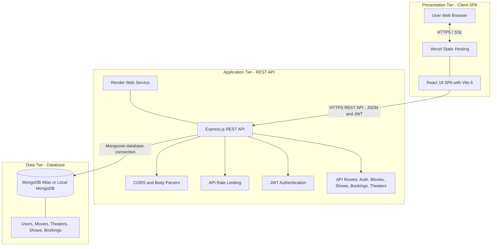
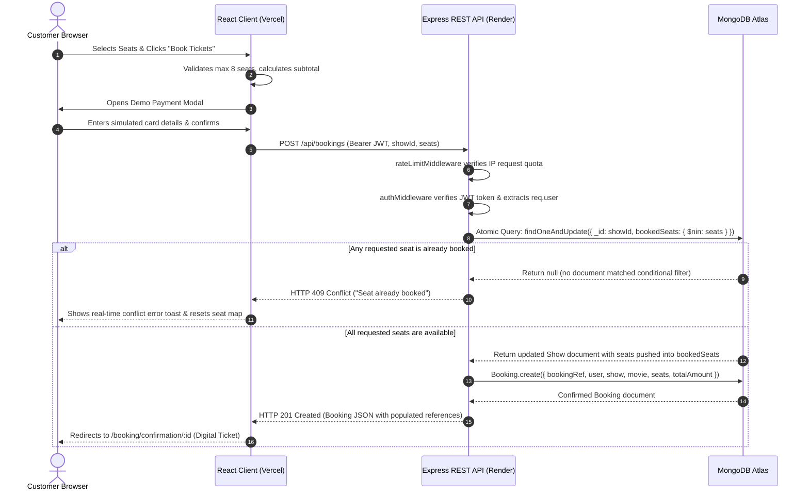

# Technical Architecture & Deployment Topology

This document describes the high-level system architecture, multi-tier software design, technology stack, network boundaries, and production deployment topology for the **IMovies** platform.

---

## 1. System Architecture Diagram

---

## 2. Multi-Tier Architecture Breakdown

The IMovies platform employs a decoupled **three-tier client-server architecture**:

### 2.1 Presentation Tier (Frontend)
- **Framework & Scaffolding**: Built using React 18 with Vite 6 as the build system and development bundler.
- **Routing & Navigation**: Client-side single-page application (SPA) routing managed via `react-router-dom` (v6). Includes route aliases (`/movies`, `/products`, `/orders`, `/order`, `/dashboard`) to preserve backward compatibility.
- **Styling Architecture**: Bootstrap 5 framework combined with custom CSS design tokens (`custom.css`) adhering to a dark cinema palette (`#080D13` background, `#FF3548` coral-red accent, `#FFC83D` warm gold ratings).
- **Global State**: React Context (`AuthContext.jsx`) stores session state and persists JWT tokens in browser `localStorage`.
- **API Client**: Centralized Axios instance (`services/api.js`) configured with base URLs and an automated request interceptor that injects the `Authorization: Bearer <token>` header on authenticated endpoints.
- **User Portals & Management**:
  - Customer ticket reservation flow with interactive tiered seating charts (Silver, Gold, Platinum VIP).
  - Customer booking management (`MyBookingsPage.jsx`) featuring digital ticket viewing, printing (`window.print()`), and booking cancellation.
  - Administrative operations (`AdminDashboardPage.jsx`) for managing movies, shows, bookings, and theaters.
- **Deployment Platform**: Hosted on **Vercel** for low-latency static delivery and edge caching.

### 2.2 Application Tier (Backend)
- **Runtime & Web Framework**: Built on Node.js using the Express.js (v4.x) web framework.
- **Design Pattern**: Implements the Model-View-Controller (MVC) architectural pattern, separating route definitions (`routes/`), request controllers (`controllers/`), data access models (`models/`), and cross-cutting middlewares (`middleware/`).
- **Security & Authorization**:
  - Stateless JSON Web Token (`jsonwebtoken`) verification for authenticated routes via `authMiddleware.js` (`protect` and `adminOnly` guards).
  - Password hashing using `bcryptjs` with standard salt rounds (factor of 10).
  - Cross-Origin Resource Sharing (`cors`) configured for client communication.
- **Traffic Protection & API Rate Limiting**:
  - In-memory sliding-window rate limiters (`middleware/rateLimitMiddleware.js`) protecting endpoints:
    - `/api/auth/login` and `/api/auth/register`: Throttles brute-force credential attempts (20 requests per 15-minute window).
    - `/api/bookings`: Throttles booking and reservation requests (30 requests per 15-minute window) to prevent automated ticket hoarding.
    - Global `/api`: General API abuse protection (250 requests per 15-minute window).
    - When limits are exceeded, the API returns **HTTP 429 Too Many Requests** with standard `Retry-After` headers.
- **Atomic Concurrency & Seat Management**:
  - **Atomic Seat Reservation**: Booking requests execute conditional lock-free atomic queries (`Show.findOneAndUpdate` matching `{ bookedSeats: { $nin: seats } }` with `$push: { bookedSeats: { $each: seats } }`). If any requested seat was secured concurrently by another user, the filter matches no documents, returning **HTTP 409 Conflict** without risking double-bookings or data corruption.
  - **Booking Cancellation & Atomic Seat Release**: Authenticated users can cancel their bookings via `PUT /api/bookings/:id/cancel`. The backend validates ownership (`booking.user === req.user._id` or admin role), checks idempotency (`paymentStatus !== 'cancelled'`), atomically releases reserved seats using `Show.findByIdAndUpdate(booking.show, { $pull: { bookedSeats: { $in: booking.seats } } })`, and updates the booking status to `cancelled`.
- **Deployment Platform**: Hosted as a cloud web service on **Render**, running Node.js in production mode (`NODE_ENV=production`).

### 2.3 Data Tier (Database)
- **Database Engine**: MongoDB, a document-oriented NoSQL database.
- **Object Data Modeling (ODM)**: Mongoose (v8.x), providing schema definitions, type casting, pre-save hooks, virtual population, and declarative indexing.
- **Collections & Data Entities**:
  - `users`: Registered customers and administrators with hashed credentials and roles (`user`, `admin`).
  - `movies`: Movie catalog records containing metadata, genres, duration, release dates, poster/banner URLs, and user ratings.
  - `theaters`: Venue records (`theatreName`, `theatreId`, `location`, `screenType`, seating tier counts, and pricing tiers).
  - `shows`: Scheduled screening sessions linking movies and theaters with date (`YYYY-MM-DD`), time (`HH:MM`), tiered pricing, total seats, and `bookedSeats` array.
  - `bookings`: Customer reservations with unique reference code (`IM-XXXXXX`), user link, show link, reserved seat list, total price, and payment status (`completed`, `cancelled`).
- **Hosting Environment**: **MongoDB Atlas** managed cloud database (with local MongoDB support for offline development). Uses TLS transport encryption and connection pooling via Mongoose. Automated continuous backups and point-in-time recovery depend on the specific cluster tier provisioned (e.g., dedicated vs. shared tier).

---

## 3. Communication Protocols & Data Flow

### 3.1 Ticket Booking & Concurrency Flow



### 3.2 Booking Cancellation & Atomic Seat Release Flow

```sequenceDiagram
    autonumber
    actor Customer
    participant Client as React Client
    participant Server as Express API
    participant DB as MongoDB

    Customer->>Client: Select Cancel Booking
    Client->>Customer: Display confirmation prompt
    Customer->>Client: Confirm cancellation
    Client->>Server: PUT /api/bookings/:id/cancel
    Server->>Server: Verify JWT authentication
    Server->>DB: Find booking by ID
    DB-->>Server: Return booking document
    Server->>Server: Verify ownership or admin role
    Server->>Server: Check cancellation status

    alt Booking already cancelled
        Server-->>Client: Return cancellation error
    else Booking can be cancelled
        Server->>DB: Release reserved seats atomically
        Note right of DB: Remove seats using pull and in
        DB-->>Server: Confirm seat release
        Server->>DB: Update booking status
        DB-->>Server: Return updated booking
        Server-->>Client: Return cancellation result
        Client-->>Customer: Update booking status
    end
```

---

## 4. Environment Decoupling & Configuration

The application strictly isolates configuration across local development and production environments using environment variables:

| Layer | Environment Variable | Development Setting | Production Setting | Description |
|---|---|---|---|---|
| **Backend** | `PORT` | `5001` | Assigned dynamically by hosting platform (e.g. Render) | Port on which Express server listens |
| **Backend** | `NODE_ENV` | `development` | `production` | Node execution environment |
| **Backend** | `MONGODB_URI` | `mongodb://localhost:27017/imovies` | `mongodb+srv://<username>:<password>@<cluster>.mongodb.net/imovies` | MongoDB connection URI |
| **Backend** | `JWT_SECRET` | Development placeholder string | Cryptographically random secret string | Key for signing and verifying tokens |
| **Backend** | `JWT_EXPIRES_IN` | `7d` | `7d` | Token validity duration |
| **Backend** | `CLIENT_URL` | `http://localhost:5173` | Production client URL / domain | Client origin configuration |
| **Frontend** | `VITE_API_URL` | `http://localhost:5001/api` | `https://<backend-host>.onrender.com/api` | Base URL for backend REST API |

---

## 5. Security & Isolation Controls

1. **Secret Redaction**: Environment files (`.env`) are excluded from version control via `.gitignore`.
2. **Stateless Authentication**: Sessions are managed via signed JSON Web Tokens stored client-side in `localStorage`, permitting zero-downtime restarts and horizontal scalability on cloud hosts.
3. **Password Security**: Passwords are encrypted with `bcryptjs` and stripped from API JSON responses via Mongoose's `toJSON()` transform.
4. **Parameterized Queries**: All database lookups are executed through Mongoose schema query builders, protecting against NoSQL injection vulnerabilities.
5. **API Abuse Protection**: In-memory sliding-window rate limiters mitigate credential brute-force attacks (`/api/auth/*`) and automated ticket scalping/hoarding (`/api/bookings`).
6. **Authorization & Ownership Enforcement**: Role-based access guards restrict administrative endpoints to authenticated administrators, while resource ownership checks prevent users from viewing or cancelling tickets belonging to other accounts.
