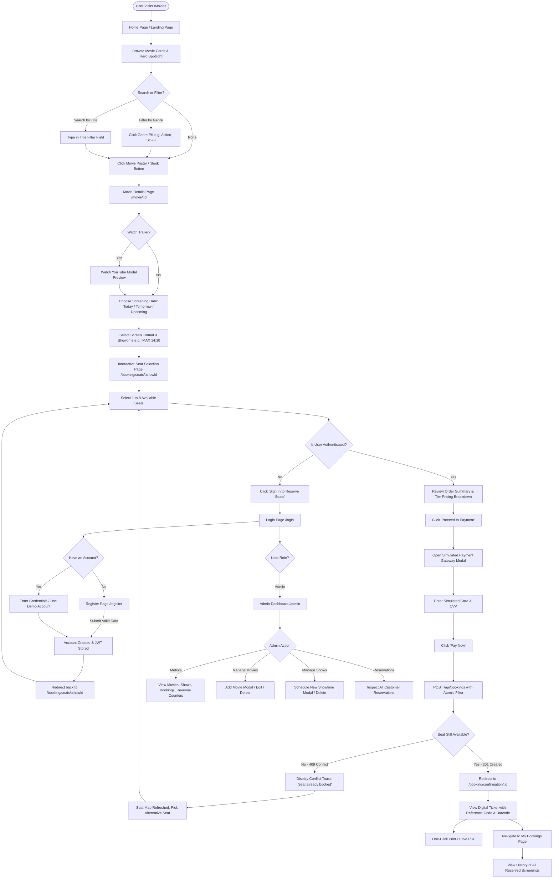

# User Flow & Interaction Lifecycle

This document maps the user journeys, state transitions, authentication gates, and operational flows across the **IMovies** platform for guests, registered customers, and administrators.

---

## 1. Comprehensive User Journey Flowchart

---

## 2. Persona-Specific Interaction Flows

### 2.1 Guest (Unauthenticated Visitor) Flow
1. **Landing & Exploration**:
   - Lands on `HomePage.jsx` (`/`).
   - Views the Hero Spotlight showcasing trending movies with synopsis and duration.
   - Filters the movie grid using compact genre chips (All, Action, Sci-Fi, Drama) or title search.
2. **Movie Inspection**:
   - Clicks on a movie card to open `MovieDetailsPage.jsx` (`/movie/:id`).
   - Reviews cast, director, synopsis, and rating.
   - Clicks **Watch Trailer** to launch the embedded YouTube modal preview.
3. **Showtime Selection**:
   - Selects a target calendar date (Today, Tomorrow, or subsequent dates).
   - Reviews available screen formats (**IMAX Laser 3D**, **Dolby Cinema Atmos**, **4DX**, **Digital Standard**) and clicks a time slot.
4. **Authentication Gate**:
   - On the interactive seat layout (`SeatBookingPage.jsx`), guest can explore available seats.
   - When attempting to book, the interface prompts the guest to **Sign In** or **Register**.
   - After authenticating, the user is redirected back to complete the booking.

---

### 2.2 Customer (Authenticated User) Booking Lifecycle
1. **Interactive Seating Chart**:
   - Views the cinema projection screen banner.
   - Interactive seats color-coded by state:
     - **Available** (Dark slate blue outline)
     - **Selected** (Active coral-red highlight)
     - **Booked** (Dark muted grey, non-clickable)
   - Visual tiers:
     - **Silver Tier** (Rows A–B): $10.00
     - **Gold Tier** (Rows C–D): $15.00
     - **Platinum VIP Tier** (Rows E–F): $22.00
2. **Order Summary Calculation**:
   - Dynamic real-time calculation of subtotal based on selected tiers.
   - Enforces a maximum limit of **8 seats per transaction**.
   - Standard administrative convenience fee added ($2.50).
3. **Simulated Payment Sandbox**:
   - Clicking **"Proceed to Payment"** opens the demo payment modal.
   - User inputs test card details (no actual monetary charge).
   - Displays sandbox badge: *"Simulated payment gateway. No real transaction will occur."*
4. **Atomic Booking & Digital Ticket Issuance**:
   - Submits `POST /api/bookings`.
   - On success (HTTP 201), redirects to `BookingConfirmationPage.jsx`.
   - Renders `DigitalTicket.jsx` featuring:
     - Unique alphanumeric Reference ID (`IM-XXXXXX`).
     - Movie title, auditorium, screening date, and time.
     - Booked seat numbers and total amount paid.
     - Simulated barcode and one-click print function.
5. **Booking History**:
   - User can navigate to `MyBookingsPage.jsx` (`/my-bookings`) at any time to inspect past tickets and reopen digital ticket modals.

---

### 2.3 Administrator Management Flow
1. **Admin Access**:
   - Authenticated users with `role: 'admin'` access `AdminDashboardPage.jsx` (`/admin`).
   - Unauthenticated or regular users are blocked by `AdminRoute.jsx` and redirected to `/`.
2. **Key Performance Indicators (KPIs)**:
   - Real-time stat cards displaying Total Movies, Active Shows, Total Bookings, and Total Demo Revenue.
3. **Movie Catalog Management**:
   - **Add Movie**: Launches modal to enter title, description, poster URL, banner URL, trailer URL, genres, duration, rating, director, and cast.
   - **Edit Movie**: Updates existing movie metadata in place.
   - **Delete Movie**: Deletes movie from catalog and cleans up associated show schedules.
4. **Showtime Scheduling**:
   - Selects movie from dropdown.
   - Selects screen type (`Standard`, `IMAX`, `4DX`, `VIP`) and enters auditorium name.
   - Configures show date (`YYYY-MM-DD`), show time (`HH:MM`), and custom tiered ticket prices (`silver`, `gold`, `platinum`).
   - Schedules the screening to immediately appear in customer discovery.
5. **Reservations Oversight**:
   - Monitors a live table of all customer bookings displaying reference codes, movie titles, customer names, seat numbers, total amounts, and booking timestamps.
