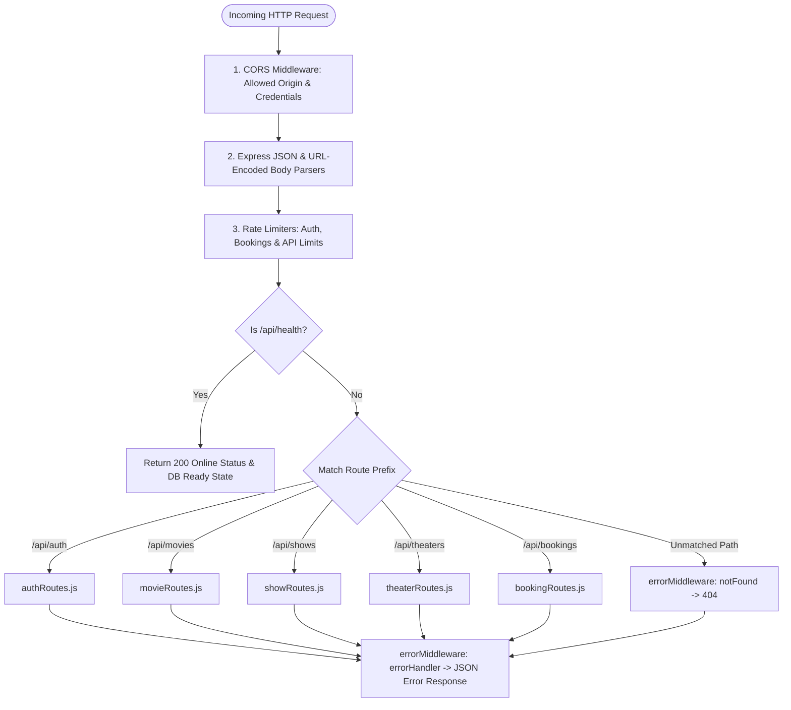

# Backend Development & Technical Explanation

This document provides an exhaustive technical explanation of the backend architecture, controller logic, middleware pipeline, concurrency management, database connection lifecycle, and automated testing suite for the **IMovies** REST API.

---

## 1. Application Entrypoint & Middleware Pipeline (`backend/server.js`)

The backend entrypoint (`server.js`) initializes the Express application and arranges the global middleware pipeline in strict sequential order:



### Key Configurations in `server.js`:
1. **Database Initialization**: Invokes `connectDB()` immediately upon boot.
2. **CORS Policy**: Configured via `cors({ origin: '*', credentials: true })` to support cross-origin API invocation from local development servers (`http://localhost:5173`) and production edge deployments (Vercel).
3. **Rate Limiting Protection**: `rateLimitMiddleware.js` applies dedicated throttles on `/api/auth/login`, `/api/auth/register`, `/api/bookings`, and globally across `/api`.
4. **Health Check Endpoint (`GET /api/health`)**: Exposes a real-time system monitor reporting server availability, UTC timestamp, and MongoDB connection status.
5. **Conditional Listener**: Exports `app` and checks `process.env.NODE_ENV !== 'test'` before executing `app.listen(PORT)`, enabling Supertest to spin up ephemeral test servers without port collision.

---

## 2. Database Connection Architecture (`backend/config/db.js`)

The database connection handler encapsulates connection management, timeout resilience, and operational diagnostics:

- **Connection Resiliency**: Configured with `serverSelectionTimeoutMS: 5000` to prevent indefinite server blocking if MongoDB is temporarily unreachable.
- **Dynamic URI Fallback**: Resolves `process.env.MONGODB_URI` first (supporting MongoDB Atlas), falling back safely to local development (`mongodb://localhost:27017/imovies`).
- **State Reporting**: The exported `getDBStatus()` function inspects `mongoose.connection.readyState` (0 = disconnected, 1 = connected, 2 = connecting, 3 = disconnecting), providing real-time database diagnostics to the health check endpoint.

---

## 3. Middleware Architecture (`backend/middleware/`)

### 3.1 Authentication & Authorization (`authMiddleware.js`)
- **`protect`**:
  1. Inspects the HTTP request headers for `authorization`.
  2. Ensures the scheme starts with `Bearer `.
  3. Extracts the token and verifies it using `jwt.verify(token, process.env.JWT_SECRET)`.
  4. Queries `User.findById(decoded.id).select('-password')` and attaches the user document to `req.user`.
  5. Catches token expiration or signature tampering, returning HTTP 401 Unauthorized.
- **`adminOnly`**:
  - Verifies that `req.user.role === 'admin'`.
  - Rejects non-administrative users with HTTP 403 Forbidden.

### 3.2 In-Memory API Rate Limiting (`rateLimitMiddleware.js`)
- Employs an in-memory sliding window map tracking requests per IP address with automated periodic garbage collection.
- Exposes:
  - `authLimiter`: Max 20 requests per 15 minutes (protects login and register).
  - `bookingLimiter`: Max 30 requests per 15 minutes.
  - `apiLimiter`: Max 250 requests per 15 minutes.
- Returns standard rate limiting headers (`X-RateLimit-Limit`, `X-RateLimit-Remaining`, `X-RateLimit-Reset`, `Retry-After`) and responds with HTTP 429 Too Many Requests when limits are exceeded.

### 3.3 Error Handling Pipeline (`errorMiddleware.js`)
- **`notFound`**: Catches unmatched routes, constructing an `Error('Not Found - ' + req.originalUrl)` passed to `next()`.
- **`errorHandler`**:
  - Normalizes HTTP status codes (defaults to 500).
  - Handles Mongoose CastErrors (invalid ObjectIds) as 404 Not Found.
  - Formats responses into uniform JSON: `{ success: false, message: error.message, stack: process.env.NODE_ENV === 'production' ? null : error.stack }`.

---

## 4. Controller Modules & Business Logic (`backend/controllers/`)

### 4.1 Authentication Controller (`authController.js`)
- **`registerUser`**: Validates credentials, checks email uniqueness, creates `User` (triggers bcrypt hash pre-save hook), returns 7-day JWT token.
- **`loginUser`**: Validates email/password via `user.matchPassword(password)`, returns signed JWT token and user profile.
- **`getCurrentUser`**: Returns `req.user` profile for session re-hydration on client reload.

### 4.2 Movie Controller (`movieController.js`)
- **`getMovies`**: Supports text search (`?search=`) and genre filtering (`?genre=`).
- **`getDistinctGenres`**: Executes `Movie.distinct('genres')` for dynamic frontend chips.
- **`createMovie` / `updateMovie` / `deleteMovie`**: Administrative CRUD actions; deleting a movie cascades to remove associated shows.

### 4.3 Theater Controller (`theaterController.js`)
- Fulfills the **SkillWallet Add Theater** requirement (PDF pages 20–21).
- **`getTheaters`**: Returns active theaters sorted by creation date.
- **`createTheater`**: Records theater name, location, screen formats, and tiered pricing (balcony, middle, lower).
- **`deleteTheater`**: Admin action removing a theater complex.

### 4.4 Show Controller (`showController.js`)
- **`getShowsByMovie`**: Retrieves screenings grouped by movie ID and calendar date (`?date=YYYY-MM-DD`).
- **`getShowById`**: Returns show details, screen type, tiered pricing, and `bookedSeats` array.
- **`createShow`**: Schedules showtimes, supporting optional linkage to a `Theater` document.
- **`deleteShow`**: Removes a scheduled showtime (admin only).

### 4.5 Booking Controller (`bookingController.js`)
- **`createBooking`**: Orchestrates ticket reservations with atomic conditional concurrency protection.
- **`cancelBooking`**:
  - Validates ownership (only the booking owner or an admin can cancel).
  - Rejects if already cancelled.
  - **Atomically releases reserved seats**: Executes `Show.findByIdAndUpdate(booking.show, { $pull: { bookedSeats: { $in: booking.seats } } })`.
  - Sets `paymentStatus = 'cancelled'`.
- **`getMyBookings`**: Queries `Booking.find({ user: req.user._id })`, deeply populated, sorted chronologically.
- **`getBookingById`**: Resolves reservations by ObjectId or alphanumeric reference code (`bookingRef`).
- **`getAllBookings`**: Returns all reservations across all movies and customers for administrative auditing.
- **`getAdminStats`**: Uses MongoDB aggregation pipeline (`$match`, `$group`) to compute live revenue metrics.

---

## 5. Concurrency Management & Safe Seat Cancellation

### 5.1 Atomic Reservation Algorithm
```javascript
// Atomic lock-free conditional update
const updatedShow = await Show.findOneAndUpdate(
  {
    _id: showId,
    bookedSeats: { $nin: seats }, // CONDITIONAL FILTER: NONE of requested seats can exist
  },
  {
    $push: { bookedSeats: { $each: seats } }, // ATOMIC PUSH: Add all seats if filter matches
  },
  { new: true }
);

if (!updatedShow) {
  return res.status(409).json({
    success: false,
    message: 'Seat already booked. Please choose other seats.',
  });
}
```

### 5.2 Atomic Seat Release Algorithm
```javascript
// Release seats back into real-time availability on cancellation
// Note: MongoDB $pull uses $in to pull multiple matched array elements
await Show.findByIdAndUpdate(booking.show, {
  $pull: { bookedSeats: { $in: booking.seats } },
});
booking.paymentStatus = 'cancelled';
await booking.save();
```

---

## 6. Automated Testing Suite (`backend/tests/`)

1. **`tests/booking_logic.test.js`**:
   - Concurrency & duplicate prevention verification (returns 409 Conflict).
   - Seat limit enforcement (max 8 seats per booking).
   - Booking cancellation & seat release ($pull verification).
   - Ownership guard (blocks unauthorized cancellation attempts).
   - Rate limiting middleware behavior (verifies 429 throttling).
2. **`tests/theater.test.js`**:
   - Theater listing (`GET /api/theaters`).
   - Theater creation with pricing tiers (`POST /api/theaters`).
   - Validation failure on missing fields.
   - Theater deletion (`DELETE /api/theaters/:id`).
