# Frontend Development & Technical Explanation

This document provides a comprehensive technical overview of the client-side architecture, component hierarchy, global state management, styling system, and API service integration for the **IMovies** Single Page Application (SPA).

---

## 1. Technology Stack & Scaffolding

- **Core Library**: React 18 (`react`, `react-dom`)
- **Build Tooling & Bundler**: Vite 6 (`@vitejs/plugin-react`), enabling Fast Refresh (HMR) and optimized rollup production bundles.
- **Routing Engine**: React Router DOM (v6), enabling declarative client-side route guards and navigation history.
- **UI Framework & Icons**: Bootstrap 5 (`bootstrap` 5.3) paired with Bootstrap Icons (`bootstrap-icons` 1.11).
- **HTTP Client**: Axios (v1.7), configured with request interceptors for automated JWT injection.

---

## 2. Component Hierarchy & Application Tree

```mermaid
flowchart TD
    App["App.jsx (BrowserRouter & AuthProvider)"]
    App --> Navbar["Navbar.jsx (Brand, Navigation, Search, Auth Dropdown)"]
    App --> RoutesContainer["Routes Container"]
    App --> Footer["Footer.jsx (Cinema Branding & Sandbox Notice)"]

    RoutesContainer --> HomePage["HomePage.jsx"]
    HomePage --> HeroBanner["HeroBanner.jsx (Spotlight & YouTube Trailer Modal)"]
    HomePage --> GenreFilters["Genre Filter Chips (Pills)"]
    HomePage --> MovieGrid["Movie Cards Grid (.movie-cards-grid)"]
    MovieGrid --> MovieCard["MovieCard.jsx (2:3 Poster, Badges, 1-Click Book)"]

    RoutesContainer --> MovieDetails["MovieDetailsPage.jsx (/movie/:id)"]
    MovieDetails --> DateSelector["Multi-Day Calendar Picker"]
    MovieDetails --> FormatGrouping["Format Screenings (IMAX, Dolby, Standard)"]

    RoutesContainer --> SeatBooking["SeatBookingPage.jsx (/booking/seats/:showId)"]
    SeatBooking --> SeatLayout["SeatLayout.jsx (Screen, Silver/Gold/Platinum Tiers)"]
    SeatBooking --> OrderSummary["Dynamic Pricing Summary"]
    SeatBooking --> DemoPayment["Sandbox Payment Modal"]

    RoutesContainer --> Confirmation["BookingConfirmationPage.jsx (/booking/confirmation/:id)"]
    Confirmation --> DigitalTicket["DigitalTicket.jsx (Barcode, Ref Code, Print Button)"]

    RoutesContainer --> MyBookings["MyBookingsPage.jsx (ProtectedRoute)"]
    MyBookings --> TicketModal["Digital Ticket Viewer Modal"]

    RoutesContainer --> AdminDash["AdminDashboardPage.jsx (AdminRoute)"]
    AdminDash --> MetricCards["KPI Stats (Movies, Shows, Bookings, Revenue)"]
    AdminDash --> MovieCRUD["Movie Management & Modal Form"]
    AdminDash --> ShowScheduling["Showtime Scheduling & Modal Form"]
    AdminDash --> BookingsTable["Live Customer Reservations Oversight Table"]

    RoutesContainer --> AuthPages["LoginPage.jsx & RegisterPage.jsx"]
    AuthPages --> DemoButtons["Quick-Fill Demo Credentials"]
```



---

## 3. Global Authentication State (`frontend/src/context/AuthContext.jsx`)

User authentication and session state are centralized within an idiomatic React Context provider:

- **State Properties**:
  - `user`: Holds the authenticated user object (`_id`, `name`, `email`, `role`).
  - `token`: The active JWT string.
  - `isAuthenticated`: Boolean derived from `!!token`.
  - `isAdmin`: Boolean derived from `user?.role === 'admin'`.
  - `loading`: Boolean tracking initial token verification on page load.
- **Persistence Mechanism**:
  - Tokens and serialized user profiles are stored in browser `localStorage`.
  - On application mount, `AuthContext` checks `localStorage.getItem('token')` and queries `/api/auth/me` to verify validity, automatically re-hydrating user sessions.
- **Exposed Actions**:
  - `login(email, password)`: Dispatches API request, persists credentials, updates context state.
  - `register(name, email, password)`: Creates account, saves issued token, updates state.
  - `logout()`: Clears `localStorage` and resets context state.

---

## 4. API Client & Interceptor Pipeline (`frontend/src/services/api.js`)

All network requests are routed through a configured Axios instance:

```javascript
// frontend/src/services/api.js
const api = axios.create({
  baseURL: import.meta.env.VITE_API_URL || 'http://localhost:5001/api',
  headers: {
    'Content-Type': 'application/json',
  },
});

// Request Interceptor: Injects Bearer token automatically
api.interceptors.request.use((config) => {
  const token = localStorage.getItem('token');
  if (token) {
    config.headers.Authorization = `Bearer ${token}`;
  }
  return config;
});
```

### Encapsulated API Service Objects:
- **`authAPI`**: `register`, `login`, `getProfile`.
- **`moviesAPI`**: `getAll`, `getById`, `getGenres`, `create`, `update`, `delete`.
- **`showsAPI`**: `getByMovie`, `getById`, `getAll`, `create`, `delete`.
- **`bookingsAPI`**: `create`, `getMyBookings`, `getById`, `getAll`, `getStats`.

---

## 5. UI Components Breakdown

### 5.1 Common Components (`components/common/`)
- **`Navbar.jsx`**:
  - Desktop height locked to 72px (`min-height: 72px; max-height: 76px;`).
  - Vertically centered layout displaying Brand Logo, Home, Movies (smooth scrolls to `#movies-section`), and Coming Soon.
  - Dedicated search input triggering query navigation (`/?search=`).
  - Responsive hamburger toggle restricted to `< 992px` (`d-lg-none`).
  - User avatar dropdown menu displaying email, role badge, "My Bookings", "Admin Dashboard" (if admin), and "Log Out".
- **`Footer.jsx`**: Features branding, legal links, technology stack credits, and a sandbox demo disclosure badge.
- **`ProtectedRoute.jsx` & `AdminRoute.jsx`**: Declarative routing wrappers blocking unauthorized navigation.

### 5.2 Movie Discovery (`components/movies/`)
- **`HeroBanner.jsx`**:
  - Desktop height capped at 400px with a high-definition backdrop image and linear gradient overlay.
  - Prominent 48px title, 16px synopsis (clamped to 3 lines), rating and duration badges.
  - **"Watch Trailer"** button launching a modal with an embedded YouTube player.
- **`MovieCard.jsx`**:
  - Designed for compact grid presentation with a strict **2:3 aspect ratio** (`aspect-ratio: 2 / 3; max-height: 270px;`).
  - Rating badge (`★ 8.0+`) overlaid on top-left; duration badge on bottom-right.
  - Movie title with single-line truncation (14px) and compact genre tags (11px).
  - Pinned coral-red "Book Tickets" button (30px height).

### 5.3 Interactive Booking (`components/booking/`)
- **`SeatLayout.jsx`**:
  - Renders a curved projection screen graphic (*"Screen — Eyes This Way"*).
  - Categorizes 60 total seats into 3 pricing tiers:
    - **Silver** (Rows A–B): Front rows
    - **Gold** (Rows C–D): Middle rows
    - **Platinum VIP** (Rows E–F): Recliner back rows
  - Visual seat states:
    - *Available*: Subtle border, interactive click.
    - *Selected*: Coral-red fill with ticket icon.
    - *Reserved/Booked*: Muted dark grey, non-interactive, disabled cursor.
- **`DigitalTicket.jsx`**:
  - High-fidelity perforated cinema ticket layout.
  - Unique alphanumeric Booking Reference ID (`IM-XXXXXX`).
  - Movie title, auditorium, screening date, showtime, and seat list.
  - Mock barcode graphic and instant `window.print()` print/PDF trigger.

---

## 6. Page Architecture (`frontend/src/pages/`)

| Page Component | Route Path | Access | Key Responsibilities |
|---|---|---|---|
| **`HomePage.jsx`** | `/` | Public | Hero banner, real-time title search, genre pills filter, and compact movie grid. |
| **`MovieDetailsPage.jsx`** | `/movie/:id` | Public | Movie synopsis, director, cast, date selector, screen format groups, and time slots. |
| **`SeatBookingPage.jsx`** | `/booking/seats/:showId` | Public / Auth | Seat mapping, dynamic pricing calculation, order summary, and sandbox payment modal. |
| **`BookingConfirmationPage.jsx`** | `/booking/confirmation/:id` | Authenticated | Post-checkout confirmation and printable digital ticket view. |
| **`MyBookingsPage.jsx`** | `/my-bookings` | Authenticated | Chronological history of user tickets with modal ticket inspection. |
| **`AdminDashboardPage.jsx`** | `/admin` | Admin Only | KPI metrics, movie catalog CRUD, showtime scheduler, and reservations auditing table. |
| **`LoginPage.jsx`** | `/login` | Public | User authentication with quick-fill demo buttons. |
| **`RegisterPage.jsx`** | `/register` | Public | Customer account registration with password validation. |

---

## 7. Styling System (`frontend/src/styles/custom.css`)

The design system implements a **Cinema Dark Aesthetic** built upon CSS custom properties:

```css
:root {
  --bg-main: #080D13;          /* Deep cinema black */
  --bg-secondary: #101820;     /* Muted midnight */
  --bg-card: #111820;          /* Card container surface */
  --color-primary: #FF3548;    /* Coral red primary accent */
  --color-gold: #FFC83D;       /* Warm gold rating accent */
  --text-main: #F5F7FA;        /* High-contrast crisp white */
  --text-muted: #A6B0BE;       /* Readable secondary body */
  --border-subtle: #1E2633;    /* Clean dark grey divider */
  --font-family: 'Inter', sans-serif;
}
```

### Responsive Grid System:
The movie discovery view utilizes a CSS Grid (`.movie-cards-grid`) maintaining consistent card widths (~160px–185px) across all viewports:
- **Wide Desktop (≥ 1400px)**: 6 columns
- **Desktop (1100px–1399px)**: 5 columns
- **Tablet / Laptop (820px–1099px)**: 5 columns
- **Small Tablet (640px–819px)**: 4 columns
- **Mobile (440px–639px)**: 3 columns
- **Compact Mobile (≤ 439px)**: 2 columns
